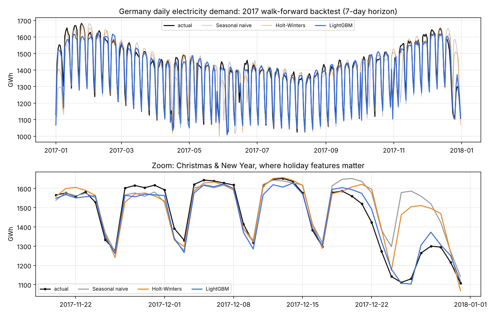
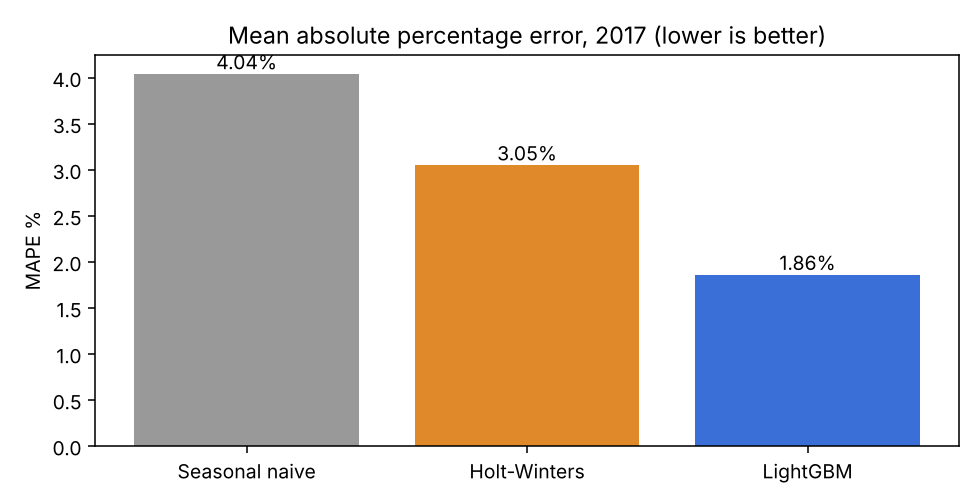
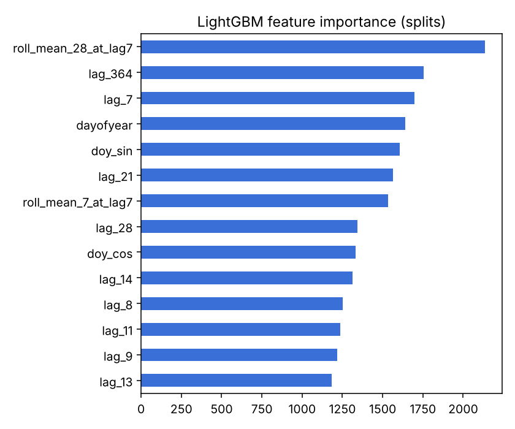

# Energy Demand Forecasting · Germany

Forecasts Germany's daily electricity consumption **7 days ahead**. A gradient-boosting model with calendar, holiday and lag features is compared with two classic baselines in a **walk-forward backtest over all of 2017**, a full year the model never trained on.

## Results (365 test days, 7-day horizon)

| Model | MAE (GWh/day) | MAPE | MAPE on holidays & Christmas |
|---|---|---|---|
| Seasonal naive (same day last week) | 54.1 | 4.04% | 19.26% |
| Holt-Winters (refit every week) | 40.1 | 3.05% | 15.45% |
| **LightGBM + calendar/holiday/lag features** | **25.8** | **1.86%** | **2.45%** |

LightGBM cuts the error by **52%** versus the seasonal-naive baseline. The biggest win is on **public holidays and the Christmas week**, where the classic models expect a normal working day and miss by 15–19%.

  
  

All numbers are in [`reports/metrics.json`](reports/metrics.json).

## How it avoids fooling itself
Time series projects often leak the future without noticing. Here:
- **Every lag is ≥ 7 days** (the forecast horizon), so a forecast made today only uses data known today. A unit test changes the "future" values and checks that the features don't move.
- The test year (2017) is never used for training or tuning.
- Holt-Winters is **refitted at every weekly forecast origin**, as it would be in production.
- Holidays come from a calendar (`holidays` package), which is known in advance.

## Features
| Group | Features |
|---|---|
| Calendar | day of week, day of year (+ sine/cosine), month |
| Holidays | German public holiday, bridge days, Christmas–New Year period |
| Lags | demand 7–14, 21, 28 and 364 days earlier |
| Rolling | 7- and 28-day means ending 7 days before the target |

## Next steps
- Add weather (temperature drives heating/cooling demand) and prediction intervals (quantile regression).
- Forecast hourly load and wind/solar generation from the same source.

## Data
[Open Power System Data](https://open-power-system-data.org/), Germany daily totals 2006–2017, via [jenfly/opsd](https://github.com/jenfly/opsd).

## Source code
The source code is kept private. I'm happy to walk through the implementation, design decisions and results in an interview: [LinkedIn](https://www.linkedin.com/in/mohamed-atef-elsayed) · [Email](mailto:mohamed300atef@gmail.com)

## Author
**Mohamed Atef Elsayed**, AI Engineer · ML Engineer · Data Scientist
[LinkedIn](https://www.linkedin.com/in/mohamed-atef-elsayed) · [Portfolio](https://mohamedatefelsayed.vercel.app)
